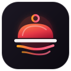

<div align="center">



# RestroFlow

### *The Intelligent Cloud Restaurant OS & POS*

**Created & Engineered by [ayubshaik01](https://github.com/ayubshaik01)**  
*Lead Architect & Maker of RestroFlow*

**Ultra-fast · Real-time Sync · Modern Web · Supabase Powered**

[](https://nextjs.org/)
[](https://react.dev/)
[](https://supabase.com/)
[](https://tailwindcss.com/)
[](https://www.typescriptlang.org/)

---

</div>

## 🚀 Overview

**RestroFlow** is a modern, enterprise-grade cloud restaurant operating system and point-of-sale platform built with **Next.js 16 (App Router)**, **React 19**, and **Supabase (PostgreSQL 16 + Realtime WebSockets)**.

Conceived and architected by **ayubshaik01**, RestroFlow replaces legacy desktop POS software with a fluid web experience that synchronizes instantly across billing terminals, kitchen display monitors, waiter mobile devices, and self-ordering kiosks.

---

## 🗺️ System Architecture & Data Flow

```
+---------------------------------------------------------------------------------------------------------+
|                                       RESTROFLOW SYSTEM TOPOLOGY                                         |
+---------------------------------------------------------------------------------------------------------+
                                                                                                           
  CLIENT SURFACES (Web & Responsive Touch)                                                                 
  +---------------------+   +---------------------+   +---------------------+   +---------------------+   
  |   POS Touch Counter |   | Kitchen KDS Monitor |   |   Waiter Handheld   |   | Guest QR Table Scan |   
  |    (/pos - 80mm)    |   |    (/kds - Audio)   |   |  (/tables - Touch)  |   |  (/order/[qrToken]) |   
  +----------+----------+   +----------+----------+   +----------+----------+   +----------+----------+   
             |                         |                         |                         |              
             +-------------------------+------------+------------+-------------------------+              
                                                    |                                                     
                                                    v                                                     
  APPLICATION RUNTIME LAYER (Next.js 16.4.2 App Router on Node 22+ / Vercel Edge)                         
  +----------------------------------------------------------------------------------------------------+  
  | - React 19 Server Components (RSC) + Dynamic Edge SSR Streaming                                    |  
  | - 142 App Router REST Route Handlers (/api/v1/*)                                                   |  
  | - TanStack React Query v5 (Optimistic Updates + Stale-While-Revalidate Engine)                     |  
  | - Security Guard: RBAC Token Verification + Bcrypt PIN Switch Engine + Owner Gatekeeper            |  
  | - Pricing Core: Tax Mode (INCLUSIVE / EXCLUSIVE GST), Modifiers & Split-Tender Payment Processor   |  
  +-------------------------------------------------+--------------------------------------------------+  
                                                    |                                                     
                                                    v                                                     
  CLOUD DATA & EVENT ENGINE (Supabase Enterprise Platform)                                                
  +----------------------------------------------------------------------------------------------------+  
  | - PostgreSQL 16 Relational Engine: 45 Tables with Foreign Keys, Cascades & Triggers                |  
  | - Row-Level Security (RLS) Policies on Tenancy (`branch_id`, `restaurant_id`)                      |  
  | - Supabase Realtime Engine: PostgreSQL WAL Broadcasts on `orders`, `kots`, `tables`, `requests`    |  
  | - Supabase Storage S3 API: Public Bucket `restaurant-assets` for Menu Photography & Logos           |  
  +----------------------------------------------------------------------------------------------------+  
```

---

## 💎 Key Features

- **⚡ Touch POS Billing**: Fast touchscreen checkout, barcode/QR scanner wedge support, custom modifiers, split bills, multi-tender payments, and tax-inclusive GST breakdown.
- **🍳 Live Kitchen Display System (KDS)**: Real-time ticket auto-routing to specific kitchen stations (Grill, Bar, Pastry, Wok) with audio alerts and status transitions.
- **🗺️ Interactive Table Floor Plan**: Dynamic drag-and-drop table layouts, live occupancy indicators, seat capacity, table transfers, and waitlist management.
- **📱 QR Table Self-Ordering**: Contactless table QR codes allowing patrons to browse menus, order food, and request assistance directly from their mobile browser.
- **🖥️ Self-Service Kiosks**: Dedicated standalone customer self-ordering touchscreen experience for quick-service and takeaway lines.
- **📦 Inventory & Recipe Costing**: Ingredient tracking, batch/lot management, automated deduction on order settlement, and food waste logging.
- **👥 Customer CRM & Loyalty**: Customer profiles, visit history, loyalty point earning and redemption, and custom gift card issuance.
- **🔒 Granular RBAC & Quick PIN Switch**: Role-based access control with fast 4-digit PIN terminal handoff across all 5 operational roles.
- **🛡️ Owner Security Controls**: Public registration is locked by default and can only be enabled by the Owner account in Settings > Security.
- **☁️ Supabase Cloud & Realtime**: PostgreSQL database with Row-Level Security (RLS) policies and live WebSocket events for zero-lag sync across all terminals.

---

## 🔐 Multi-Role Demo Credentials & PINs

All roles are active and verified in the database with the default password: `RestroFlow@123`

| Role | Email | Password | Quick PIN | Capabilities |
| :--- | :--- | :--- | :--- | :--- |
| **Owner** | `owner@demo.local` | `RestroFlow@123` | **`1111`** | Full authority, financial reports, settings, security lock, staff creation |
| **Manager** | `manager@demo.local` | `RestroFlow@123` | **`2222`** | Floor layout, menu management, shift schedules, attendance approvals |
| **Cashier** | `cashier@demo.local` | `RestroFlow@123` | **`3333`** | Billing, checkout, split checks, cash drawer kicks, receipts |
| **Waiter** | `waiter@demo.local` | `RestroFlow@123` | **`4444`** | Table ordering, guest modifications, kitchen fire requests |
| **Chef** | `chef@demo.local` | `RestroFlow@123` | **`5555`** | Kitchen Display System (KDS), station routing, priority rush sorting |

---

## 🔄 End-to-End Order & Kitchen Flow

```
[GUEST / WAITER]               [POS BILLING CORE]                 [KDS KITCHEN]                  [SETTLEMENT / CASHIER]
       |                                |                              |                                  |
       |--- 1. Select Table 4 --------->|                              |                                  |
       |--- 2. Add Items & Modifiers -->|                              |                                  |
       |                                |-- 3. Price & Tax Inclusive ->|                                  |
       |                                |-- 4. Write `orders` & Items ->|                                  |
       |                                |-- 5. Realtime WS Broadcast ->|                                  |
       |                                |                              |--- 6. Audio Chime & Ticket ----->|
       |                                |                              |--- 7. Chef Marks 'PREPARING' --->|
       |                                |                              |--- 8. Chef Marks 'READY' ------->|
       |<-- 9. Food Delivered ----------+                              |                                  |
       |                                                                                                  |
       |--- 10. Request Bill / Payment ------------------------------------------------------------------>|
       |                                                               |-- 11. Split Tender (Card/Cash) ->|
       |                                                               |-- 12. ESC/POS Receipt Printed -->|
       |                                                               |-- 13. Cash Drawer Kicked ------->|
       |                                                               |-- 14. Inventory Auto-Deducted -->|
       |<-- 15. Table Released (AVAILABLE) ----------------------------|-- 16. Order Marked PAID -------->|
```

---

## 🏗️ Architecture Blueprint

```
RestroFlow/
├── app/                  # Next.js 16 App Router pages and API routes
│   ├── (dashboard)/      # Protected operational screens (POS, KDS, Tables, Inventory, etc.)
│   ├── api/v1/           # High-performance Supabase API route handlers (142 routes)
│   ├── docs/             # In-app user guides, API docs, and compliance manuals
│   ├── order/[qrToken]/  # Public guest QR order-at-table experience
│   ├── kiosk/[token]/    # Self-service ordering kiosk UI
│   ├── login/ & signup/  # Authentication & onboarding
│   └── layout.tsx        # App layout with theme providers & brand metadata
├── components/           # Reusable UI & domain-specific components
│   ├── layout/           # AppShell, RestroFlowLogo, Sidebar, Navbars
│   ├── pos/              # POS billing grid, modifiers, checkout panel
│   ├── kds/              # Kitchen ticket cards, station switchers
│   ├── tables/           # Floor plan visualizer, table tiles
│   └── ui/               # Tailored UI components
├── hooks/                # Custom React hooks (Supabase realtime, queries, mutators)
├── lib/                  # Business logic (pricing, settlement, receipts, Supabase clients)
│   ├── supabase/         # Browser, Server, Admin, and Storage clients
│   └── orders/           # Calculation engines, receipt and KOT renderers
├── types/                # Strict TypeScript domain interfaces and Zod schemas
└── supabase/             # SQL migrations, RLS policies, and seed data
    ├── migrations/       # Production schema migration (45 tables)
    └── seed.sql          # Initial permissions, roles, and sample restaurant data
```

---

## 🏁 Getting Started

### Prerequisites

- **Node.js**: v20 or v22+ (`node -v`)
- **npm** or **pnpm**
- A **Supabase** project ([supabase.com](https://supabase.com))

### 1. Installation

```bash
git clone <your-repo-url>
cd restroflow
npm install
```

### 2. Configure Environment Variables

Create a `.env.local` file at the root:

```env
# Supabase Configuration
NEXT_PUBLIC_SUPABASE_URL=https://your-project.supabase.co
NEXT_PUBLIC_SUPABASE_ANON_KEY=your-anon-publishable-key
SUPABASE_SERVICE_ROLE_KEY=your-service-role-secret-key

# App URL
NEXT_PUBLIC_APP_URL=http://localhost:3000
```

### 3. Initialize Supabase Database

1. Open your Supabase project's **SQL Editor**.
2. Run `supabase/migrations/20261104000000_initial_schema.sql` to generate all tables, RLS policies, and realtime publications.
3. Run `supabase/seed.sql` to populate initial system roles, default permissions, and demo restaurant data.

### 4. Start Development Server

```bash
npm run dev
```

Visit [http://localhost:3000](http://localhost:3000) to access RestroFlow.

---

## 🛡️ Production Build & Verification

```bash
# Strict TypeScript Typecheck
npm run typecheck

# Production Web Build
npm run build

# Start Production Server
npm start
```

---

## 📚 Complete Guides & Documents

- **Word Document Guide**: Comprehensive formatted guide available in [`RESTROFLOW-PROJECT-GUIDE.docx`](RESTROFLOW-PROJECT-GUIDE.docx).
- **Database & Architecture Reference**: Full table schema and operations manual in [`SUPABASE_SETUP.md`](SUPABASE_SETUP.md).
- **In-App Operations Manual**: Live at `http://localhost:3000/docs/user-guide`.

---

## 👨‍💻 Creator & Maker

**RestroFlow** was created and engineered by **ayubshaik01** ([GitHub](https://github.com/ayubshaik01)).  
Lead Architect & Maker of RestroFlow. Built for modern restaurant excellence.
